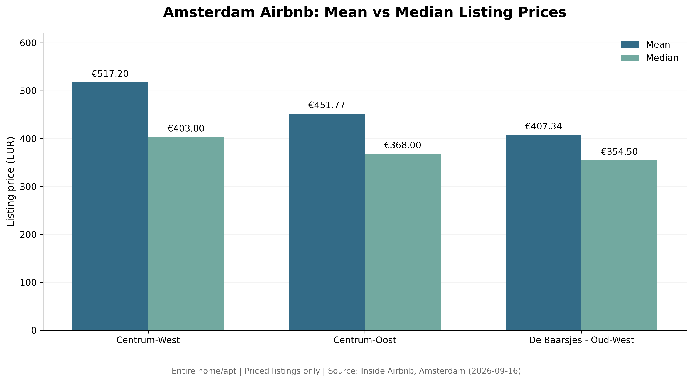
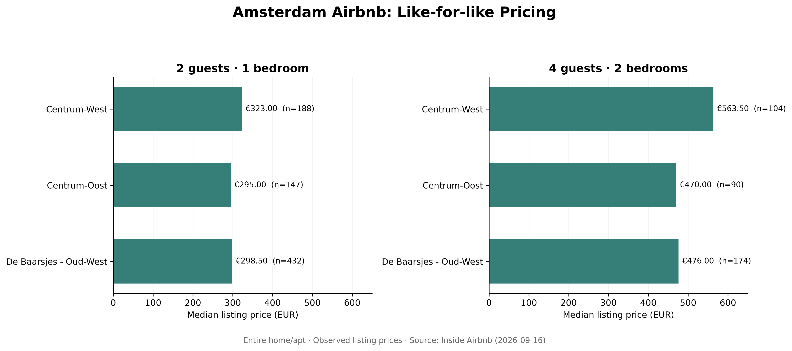

# Amsterdam Airbnb Market Intelligence

## Project Overview

<!-- Explain the business problem and project objective. -->

## Business Questions

<!-- What questions does the analysis aim to answer? -->

## Dataset

<!-- Source, snapshot date, scope and data coverage. -->

## Methodology

<!-- SQL, Python, cleaning, IQR, like-for-like comparison. -->

## Key Findings

<!-- Summarize the most important validated findings. -->

## Visualizations

## Reproducibility

<!-- Explain how to reconstruct the dataset and analyses. -->

## Limitations

<!-- Missing prices, asking prices, unobserved attributes. -->
